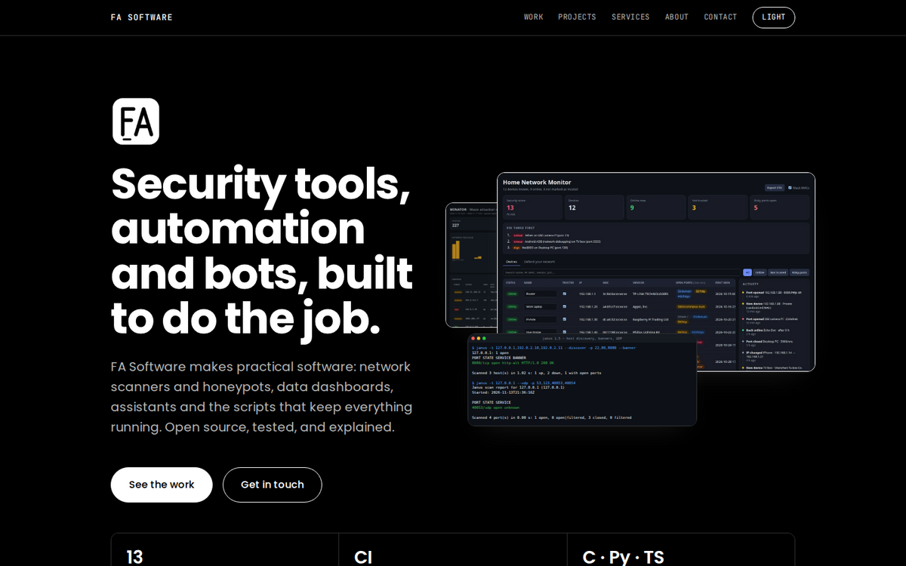
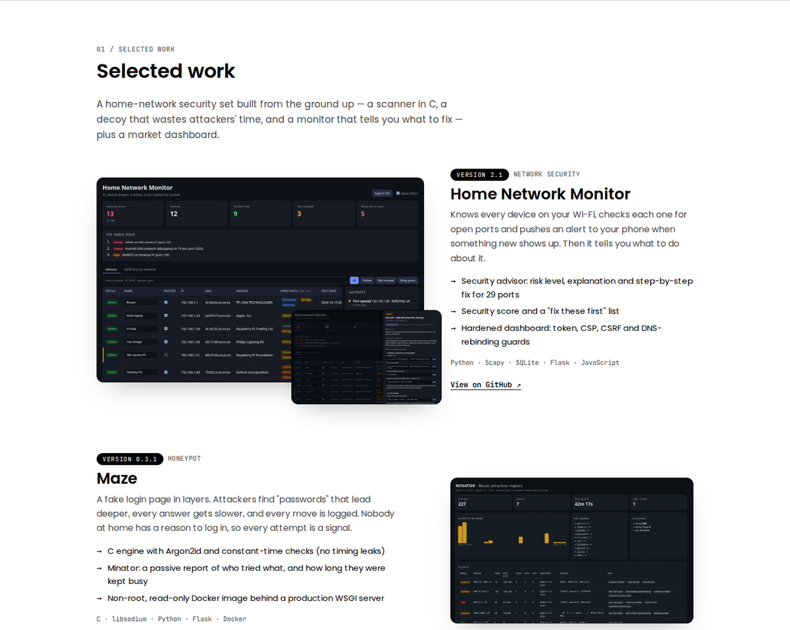

# FA Software — Website

Single-page portfolio site for **FA Software**: network security tools, automation, data, bots and web.

Plain HTML, CSS and JavaScript. No frameworks, no build step.

<p align="center">
  
  
</p>

## Features

- Black and white design, mobile-first and responsive; the colour comes only from real project screenshots
- **Selected work:** the main projects (Home Network Monitor, Maze, Janus, Heimdall) as case studies with large screenshots, highlights and tech
- **More projects:** a grid of every other public project with a thumbnail (greyscale until hovered, on devices that can hover)
- Screenshots open in a lightbox (`<dialog>`), images are lazy-loaded WebP or SVG with fixed dimensions (no layout shift)
- Hero collage of real screenshots, section navigation in the header
- Light and dark mode: follows the system preference, has a toggle, and remembers the choice in `localStorage`
- Logo switches with the theme
- Semantic HTML, alt texts, skip link and keyboard-friendly focus styles
- Respects `prefers-reduced-motion`; the theme toggle is hidden when JavaScript is off
- Tab icon follows the system theme (black logo on light tabs, white logo on dark tabs)
- Basic link-preview tags (Open Graph and Twitter card)
- Strict Content-Security-Policy (no inline scripts or styles; only Google Fonts as an outside source) and `no-referrer`
- Project cards list the current versions of every public FA Software project
- Checked in Chromium at 1440 px and 390 px, light and dark: no console errors, no horizontal scroll

## Structure

```
index.html          Page content (hero, selected work, more projects, services, about, contact)
css/style.css       All styles and theme tokens
js/theme-init.js    Applies the saved or system theme before first paint
js/main.js          Theme toggle and screenshot lightbox
assets/
  logo-dark.png     Black logo, used on light backgrounds
  logo-light.png    White logo, used on dark backgrounds
  projects/         Project screenshots (WebP, cropped to 16:10) and terminal recordings (SVG)
tools/
  check_site.py     Sanity checks (broken links, missing files, alt texts, placeholders)
.github/workflows/
  check.yml         Runs the checks on every push
```

## Run locally

Open `index.html` in a browser, or serve the folder:

```bash
python3 -m http.server 8000
```

Then visit http://localhost:8000.

## Editing

- **Main projects:** each is an `<article class="case">` in `index.html`; add `case--flip` to put the image on the right. A screenshot is a `<button class="shot" data-full="...">` so it opens in the lightbox; `shot--inset` overlaps a second, smaller one.
- **Other projects:** each card is an `<li class="card">`; `card--soon` gives the dashed "in progress" strip.
- **New screenshots:** crop to 16:10 and convert, e.g. `magick shot.png -crop 1440x900+0+0 -resize 1400x -strip -quality 82 assets/projects/name.webp`.
- **Theme colors:** CSS variables at the top of `css/style.css`.

## Checks

```bash
python3 tools/check_site.py            # errors fail, leftover placeholders only warn
python3 tools/check_site.py --strict   # run this before publishing
```

The checks cover missing local files, `#anchors` without a matching id, images without `alt`, links that open a new tab without `rel="noopener"`, duplicate ids and leftover `[PLACEHOLDER]` text.

## Before you publish

- [x] Replace `[YOUR NAME]` in the About section (the strict check fails until you do).
- [ ] Check the project cards: a card is "Coming soon" only while its repository is private or does not exist yet. Remove `project--soon` and add the GitHub link once it is public.
- [ ] Once the final address and a preview image (about 1200×630 px) exist, add `og:url`, `og:image` and a `<link rel="canonical">` to the `<head>`.
- [ ] Fonts load from Google Fonts. If your visitors include people in the EU, consider hosting the two font files yourself so no visitor data goes to Google.

## Deploy (GitHub Pages)

Settings → Pages → Source: *Deploy from a branch* → `main` / root.

Note: GitHub Pages on a private repository requires a paid GitHub plan. On a free plan, the repository must be public to publish the site.

## Contact

- Email: anil.hyperborea@gmail.com
- GitHub: [fas0ftware](https://github.com/fas0ftware)
- Instagram: [@fa.software](https://instagram.com/fa.software)
